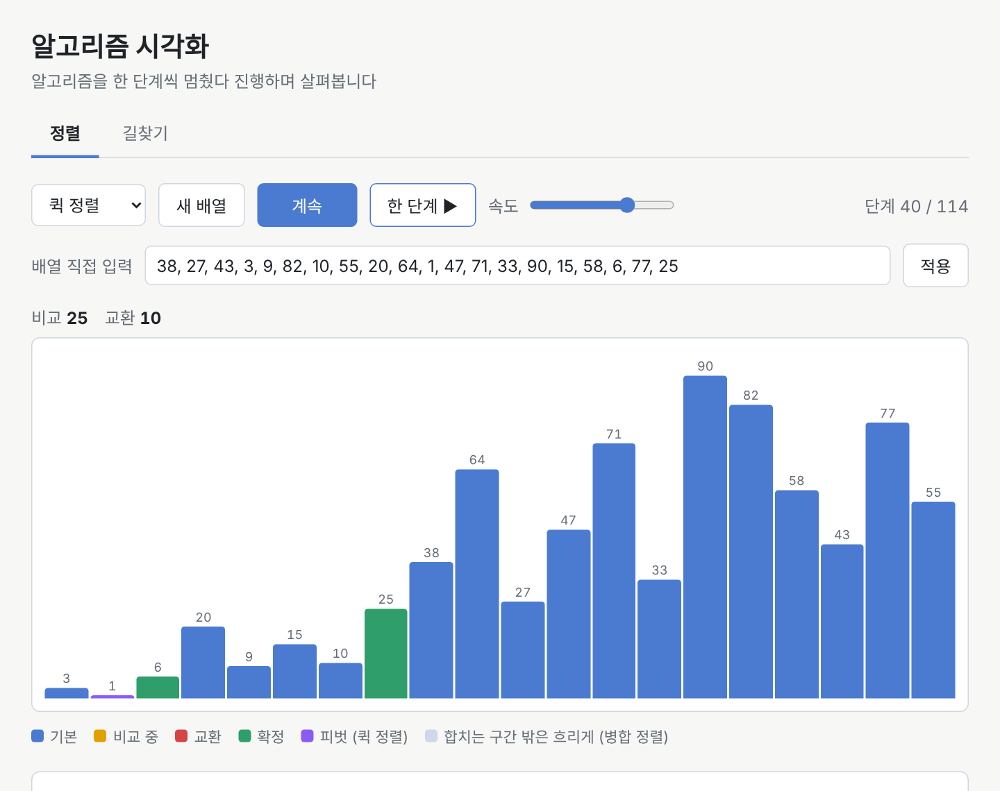
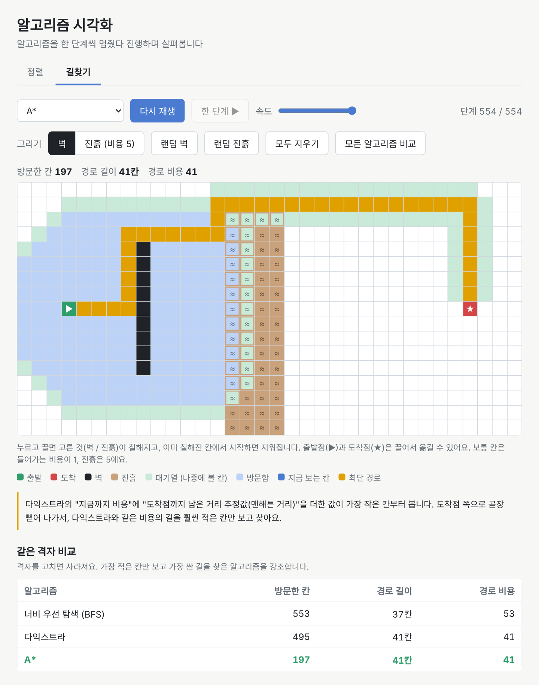
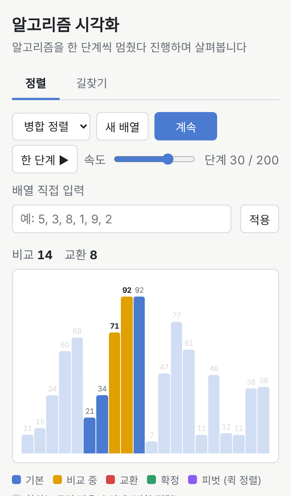

# 알고리즘 시각화

정렬과 길찾기 알고리즘을 **한 단계씩 멈췄다 진행하며** 살펴보는 웹 페이지입니다.
설치 없이 브라우저에서 바로 쓸 수 있고, 휴대폰에서도 동작해요.

**👉 [사이트 바로가기](https://hotmericano.github.io/algorithm-visualizer/)** · [길찾기 화면으로 바로가기](https://hotmericano.github.io/algorithm-visualizer/#path)



## 주요 기능

### 정렬
- **5가지 정렬**: 버블, 선택, 삽입, 퀵, 병합
- **재생 컨트롤**: 시작 / 일시정지 / 한 단계씩 / 속도 조절
- **색으로 보는 과정**: 비교(노랑), 교환(빨강), 확정(초록), 피벗(보라, 퀵 정렬), 합치는 구간만 또렷하게(병합 정렬)
- **배열 직접 입력**: `64, 25, 12, 22, 11`처럼 넣으면 그 배열로 정렬. 막대 위에 값 표시
- **같은 배열 비교표**: 알고리즘만 바꿔 가며 비교·교환 횟수를 표로 비교
- **설명 패널**: 동작 원리, 시간 복잡도(최선 / 평균 / 최악), 추가 메모리, 안정 정렬 여부

### 길찾기
- **3가지 탐색**: 너비 우선 탐색(BFS), 다익스트라, A*
- **격자 편집**: 끌어서 벽과 진흙(지나가는 비용 5) 그리기, 출발점·도착점 끌어서 옮기기, 랜덤 벽·진흙
- **탐색 과정 재생**: 대기열, 방문한 칸, 지금 보는 칸, 최단 경로를 색으로 표시
- **같은 격자 비교표**: 세 알고리즘의 방문한 칸 수, 경로 길이, 경로 비용을 한 번에 비교



위 화면에서 BFS는 움직이는 횟수만 따져서 진흙을 곧장 지나가고(비용 53), 다익스트라와 A*는 돌아가서 더 싼 길(비용 41)을 찾아요.
A*는 도착점 쪽으로 곧장 뻗어 나가서 다익스트라의 절반도 안 되는 칸만 보고 같은 길을 찾습니다.

## 알고리즘 정리

### 정렬

| 알고리즘 | 최선 | 평균 | 최악 | 추가 메모리 | 안정 정렬 |
|---|---|---|---|---|---|
| 버블 정렬 | O(n) | O(n²) | O(n²) | O(1) | 예 |
| 선택 정렬 | O(n²) | O(n²) | O(n²) | O(1) | 아니요 |
| 삽입 정렬 | O(n) | O(n²) | O(n²) | O(1) | 예 |
| 퀵 정렬 | O(n log n) | O(n log n) | O(n²) | O(log n) | 아니요 |
| 병합 정렬 | O(n log n) | O(n log n) | O(n log n) | O(n) | 예 |

> 병합 정렬은 막대가 항상 실제 값과 맞도록 "제자리 병합"으로 보여줘서, 비교 횟수는 실제와 같지만 교환 횟수는 더 많게 나와요.

### 길찾기

| 알고리즘 | 다음에 볼 칸 | 사용하는 자료구조 | 찾는 경로 |
|---|---|---|---|
| BFS | 먼저 넣은 칸 | 큐 | 움직인 횟수가 가장 적은 길 |
| 다익스트라 | 지금까지 비용이 가장 적은 칸 | 우선순위 큐 (최소 힙) | 비용이 가장 적은 길 |
| A* | 지금까지 비용 + 남은 거리 추정(맨해튼 거리)이 가장 적은 칸 | 우선순위 큐 (최소 힙) | 비용이 가장 적은 길 |

## 구조

이 프로젝트의 핵심 아이디어는 **"알고리즘은 단계를 기록만 하고, 화면은 그 기록을 재생한다"** 예요.

```
알고리즘 (algorithms.js, pathfinding.js)
  └─ 단계 목록을 만든다: [{ type: 'compare', i: 0, j: 1 }, { type: 'swap', i: 0, j: 1 }, ...]
        │
        ▼
재생기 (player.js)
  └─ 단계를 하나씩 꺼낸다: 시작 / 일시정지 / 한 단계 / 속도
        │
        ▼
화면 (main.js, grid.js)
  └─ 단계 하나를 막대나 칸에 그린다
```

그래서 알고리즘은 화면을 몰라도 되고, `node`로 바로 테스트할 수 있어요.
새 알고리즘을 추가할 때도 단계 목록만 만들면 재생은 저절로 됩니다.

| 파일 | 하는 일 |
|---|---|
| `index.html` | 화면 구조 (정렬 / 길찾기 탭) |
| `style.css` | 디자인 (다크 모드, 휴대폰 대응) |
| `app.js` | 탭 전환 (`#path`로 길찾기 화면 바로 열기) |
| `player.js` | 단계 재생기: 정렬과 길찾기가 함께 씀 |
| `algorithms.js` | 정렬 알고리즘 5개와 설명 데이터 |
| `main.js` | 정렬 화면: 막대 그리기, 배열 입력, 비교표 |
| `utils.js` | 배열 입력 처리 |
| `dom.js` | 두 화면이 같이 쓰는 도우미: 드롭다운 채우기, 비교표 그리기 |
| `priorityQueue.js` | 우선순위 큐 (최소 힙) 직접 구현 |
| `pathfinding.js` | 길찾기 알고리즘 3개 |
| `grid.js` | 길찾기 화면: 격자, 벽·진흙 그리기, 비교표 |
| `tests/` | 테스트 |

## 직접 실행하기

빌드 과정이 없어서 `index.html`을 브라우저로 열면 바로 동작해요.

```bash
git clone https://github.com/Hotmericano/algorithm-visualizer.git
cd algorithm-visualizer
# index.html을 더블클릭하거나 브라우저로 열기
```

### 테스트

[Node.js](https://nodejs.org/)가 있으면 알고리즘을 테스트할 수 있어요. 따로 설치할 라이브러리는 없습니다.

```bash
node tests/run-all.js
```

| 테스트 | 확인하는 것 |
|---|---|
| `sorting.test.js` | 5개 정렬 × 9가지 배열: 교환만 따라 해도 정렬되는지, 모든 자리가 한 번씩 확정되는지, 원본이 그대로인지 |
| `pathfinding.test.js` | 글자로 그린 격자(`S..#~E`)로 최단 경로 확인, 랜덤 격자 200개에서 다익스트라와 A*의 비용이 같은지 |
| `priorityQueue.test.js` | 넣기·꺼내기 1000번을 "매번 정렬하는 느린 정답"과 비교, 힙 규칙이 항상 지켜지는지 |
| `parseArrayInput.test.js` | 배열 입력: 올바른 입력과 잘못된 입력(문자, 음수, 소수, 개수, 범위) |

## 만든 과정

이슈 → 브랜치 → 커밋 → Pull Request → 머지 흐름으로 버전별로 만들었어요.
[마일스톤](https://github.com/Hotmericano/algorithm-visualizer/milestones?state=closed)과 [Pull Request 목록](https://github.com/Hotmericano/algorithm-visualizer/pulls?q=is%3Apr+is%3Aclosed)에서 전체 기록을 볼 수 있습니다.

| 버전 | 내용 |
|---|---|
| v0.1 | 막대 그래프, 버블 정렬 단계 기록과 재생 |
| v0.2 | 재생 컨트롤, 선택·삽입 정렬, 배열 직접 입력, 비교·교환 횟수와 비교표 |
| v0.3 | 퀵 정렬, 병합 정렬, 설명 패널 |
| v0.4 | 길찾기 탭, 격자와 벽 그리기, 재생기 분리(리팩터링), BFS |
| v0.5 | 우선순위 큐, 다익스트라와 진흙 칸, A*와 비교표 |
| v1.0 | 휴대폰 대응, 배포, README |

### 기억에 남는 것
- **단계 기록 구조**: v0.1에서 단계 형식을 정해 둔 덕분에, 정렬 알고리즘을 추가할 때 재생 코드는 한 줄만 바꿨어요.
- **리팩터링**: 길찾기를 만들기 전에 재생 코드를 `player.js`로 분리해서 두 화면이 같은 코드를 씁니다. 기능 변화 없이 구조만 바꾼 PR을 따로 냈어요.
- **테스트가 잡아 준 실수**: 길찾기 테스트를 쓰다가 미로의 최단 거리를 손으로 잘못 셌는데, 테스트가 그걸 잡아 줬어요.
- **캐시 문제**: 배포 직후 새 HTML과 예전 JS가 섞여 열리는 일이 있어서, 파일 주소에 `?v=버전`을 붙였어요.

<p align="center">
  
</p>
